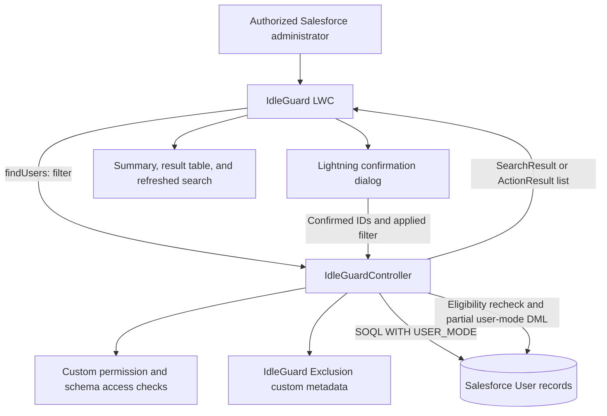

# IdleGuard: Inactive User Manager

## Technical Implementation Document

| Document detail        | Value                                                                                                         |
| ---------------------- | ------------------------------------------------------------------------------------------------------------- |
| Version                | 1.0                                                                                                           |
| Prepared               | 8 October 2026                                                                                                |
| Audience               | Salesforce developers, technical architects, administrators, testers, and support engineers                   |
| Baseline               | Current IdleGuard Apex, LWC, custom metadata, permissions, layout, and deployment manifest in this repository |
| Salesforce API version | 67.0                                                                                                          |
| Related documents      | [Functional Document](IdleGuard-Functional-Document.md) · [Installation Guide](IDLEGUARD.md)               |

## 1. Implementation overview

IdleGuard is a Salesforce-native Lightning Web Component with an Apex controller. It queries active User records, returns up to 200 eligible candidates, and performs a synchronous partial-success update of `User.IsActive` after administrator confirmation.

The implementation uses imperative Apex calls, standard Lightning base components, an opt-in custom permission, and an administrator-maintained Custom Metadata Type. There is no external API integration, scheduled job, Queueable, or Batch Apex implementation in this feature. The word "batch" refers to the displayed set of up to 200 users.

## 2. Architecture and component inventory



Paths below are relative to the repository root.

| Artifact                                                                                             | Responsibility                                                                                      |
| ---------------------------------------------------------------------------------------------------- | --------------------------------------------------------------------------------------------------- |
| `force-app/main/default/lwc/idleGuard/idleGuard.html`                                                | Filters, summary cards, notices, review table, action buttons, spinner, and results table           |
| `force-app/main/default/lwc/idleGuard/idleGuard.js`                                                  | State, client validation, imperative Apex calls, sorting, selection, confirmation, and toasts       |
| `force-app/main/default/lwc/idleGuard/idleGuard.css`                                                 | Card layout, responsive filter arrangement, notices, and table-region styling                       |
| `force-app/main/default/lwc/idleGuard/idleGuard.js-meta.xml`                                         | Exposes the component on Lightning App Pages, Home Pages, and tabs                                  |
| `force-app/main/default/classes/IdleGuardController.cls`                                             | Authorization, filter construction, exclusion loading, user queries, revalidation, and deactivation |
| `force-app/main/default/classes/IdleGuardControllerTest.cls`                                         | Apex tests for eligibility, authorization, exclusions, validation, limits, and outcome mapping      |
| `force-app/main/default/lwc/idleGuard/__tests__/`                                                    | Jest tests for UI orchestration and permission gating                                               |
| `force-app/main/default/objects/IdleGuard_Exclusion__mdt/`                                           | Exclusion type, four custom fields, and validation rule                                             |
| `force-app/main/default/customPermissions/IdleGuard_Manage_Users.customPermission-meta.xml`          | Feature authorization flag                                                                          |
| `force-app/main/default/permissionsets/IdleGuard_Admin.permissionset-meta.xml`                       | Apex class access, custom permission, and available tab access                                      |
| `force-app/main/default/layouts/IdleGuard_Exclusion__mdt-IdleGuard Exclusion Layout.layout-meta.xml` | Setup form for managing exclusion records                                                           |
| `force-app/main/default/tabs/IdleGuard.tab-meta.xml`                                                 | Native Lightning component tab                                                                      |
| `manifest/idleguard-package.xml`                                                                     | Isolated metadata deployment package                                                                |

## 3. Data model

### 3.1 Standard User data

| Field           | Usage                                                                 |
| --------------- | --------------------------------------------------------------------- |
| `Id`            | Identity, selection key, self-protection, and update target           |
| `Name`          | Display name and initial query ordering                               |
| `Email`         | Review-table email link                                               |
| `Username`      | Exact-username exclusion matching                                     |
| `Profile.Name`  | Display and client-side sorting                                       |
| `IsActive`      | Search eligibility and the only field explicitly changed by IdleGuard |
| `LastLoginDate` | Primary inactivity criterion; null indicates never logged in          |
| `CreatedDate`   | Age threshold and days-inactive calculation for never-logged-in users |

No custom field is added to User. The update payload is constructed on the server as `new User(Id = userId, IsActive = false)`; it does not accept arbitrary User field values from the client.

### 3.2 Exclusion configuration

The public Custom Metadata Type `IdleGuard_Exclusion__mdt` contains:

| Field         | Metadata type          | Behavior                                                                                 |
| ------------- | ---------------------- | ---------------------------------------------------------------------------------------- |
| `Active__c`   | Checkbox; default true | Only active records are applied.                                                         |
| `User_Id__c`  | Text(18)               | Optional User ID; accepts a valid 15- or 18-character ID through Apex parsing.           |
| `Username__c` | Text(80)               | Optional exact username; trimmed and normalized to lowercase when loaded.                |
| `Reason__c`   | Text(255)              | Optional administrator context; not used in matching and not returned in action results. |

The `Require_Account` validation rule is:

```text
AND(Active__c, ISBLANK(User_Id__c), ISBLANK(Username__c))
```

The controller loads metadata through `IdleGuard_Exclusion__mdt.getAll().values()`. It builds sets of User IDs and usernames, then applies them to both discovery and deactivation. Matching uses **User ID OR username**. Disabled records are ignored.

Invalid ID syntax or an ID belonging to a different object causes an `AuraHandledException`; processing stops rather than silently ignoring the malformed protection. Username values are not checked for existence, so a typo or outdated sandbox suffix can produce a non-matching exclusion. Review actual identities during setup and after username changes.

The layout includes the standard metadata fields `MasterLabel`, `DeveloperName`, `IsProtected`, and `NamespacePrefix`, plus the four custom fields. Standard `IsProtected` is a custom-metadata packaging property; IdleGuard's account-exclusion switch is `Active__c`.

No org-specific exclusion records are shipped in the manifest. They must be configured in each target environment.

## 4. Apex interface contracts

The class is declared `public with sharing`. Both public methods are `@AuraEnabled` and are deliberately not marked `cacheable=true`, so the LWC requests current data from Apex for each search or action.

### 4.1 `findUsers`

```apex
public static SearchResult findUsers(
    String mode,
    Integer daysInactive,
    Date startDate,
    Date endDate
)
```

| Parameter      | Contract                                                                            |
| -------------- | ----------------------------------------------------------------------------------- |
| `mode`         | Exactly `days` or `range`                                                           |
| `daysInactive` | Required integer from 1 through 3650 in days mode; the LWC sends null in range mode |
| `startDate`    | Required Date in range mode; the LWC sends null in days mode                        |
| `endDate`      | Required Date in range mode, on or before the running user's current date           |

The `Filter` constructor uses only the parameters relevant to the selected mode. It rejects invalid modes, missing required criteria, reversed ranges, and future end dates.

`SearchResult` contains:

| Property     | Type            | Meaning                                                        |
| ------------ | --------------- | -------------------------------------------------------------- |
| `users`      | `List<UserRow>` | Up to 200 review rows                                          |
| `hasMore`    | Boolean         | True when the query found a 201st candidate; not a total count |
| `batchLimit` | Integer         | 200                                                            |

Each `UserRow` exposes `userId` (Id), `name` (String), `email` (String), `profileName` (String), `lastLogin` (Datetime, nullable), `daysInactive` (Integer), and `neverLoggedIn` (Boolean).

### 4.2 `deactivateUsers`

```apex
public static List<ActionResult> deactivateUsers(
    List<Id> userIds,
    String mode,
    Integer daysInactive,
    Date startDate,
    Date endDate
)
```

The client sends explicit IDs plus the filter used to produce the reviewed list. There is no server-side "deactivate every match" flag.

The incoming list must contain between 1 and 200 elements. This check occurs **before deduplication**, so 201 copies of one ID are rejected. Null IDs and IDs for non-User objects are rejected. Duplicate valid IDs within the limit are processed once.

Each `ActionResult` exposes `userId`, `name`, `status`, and `message`. Status is one of `Deactivated`, `Skipped`, or `Failed`. Use `userId` to correlate results; the response is not guaranteed to follow the original request order because skipped results are appended before DML outcomes.

The server recomputes eligibility for the supplied IDs and filter. It does not store or cryptographically sign a previous search result. Displayed-list scoping and confirmation are UI behaviors; server authorization and eligibility checks apply independently to direct Apex requests.

## 5. Eligibility and query design

### 5.1 Common criteria

Discovery uses a static SOQL query with bound values. Both branches require `IsActive = true`, exclude `UserInfo.getUserId()`, and exclude the loaded metadata identities. Queries explicitly use `WITH USER_MODE`, order by `Name, Id`, and request `LIMIT 201`.

The extra row detects overflow without an organization-wide count query. The controller returns only the first 200 rows. The initial ordering is deterministic, including when users have the same name.

### 5.2 Days mode

The server constructs:

```text
cutoff = Datetime.now().addDays(-daysInactive)

Previously logged in: LastLoginDate <= cutoff
Never logged in:      LastLoginDate is null AND CreatedDate < cutoff
```

The last-login boundary is inclusive; the account-creation boundary is exclusive. The server recomputes the cutoff during deactivation using the submitted threshold, rather than trusting a client-provided timestamp.

### 5.3 Date-range mode

The server constructs local midnight values using `Datetime.newInstance(Date, Time)`:

```text
startTime = startDate at 00:00 in the running user's Salesforce time zone
endTime   = the day after endDate at 00:00 in the same time zone

Previously logged in: startTime <= LastLoginDate < endTime
Never logged in:      LastLoginDate is null AND CreatedDate < startTime
```

Using an exclusive next-day endpoint includes the entire selected end date without relying on a last-millisecond value. The dates define last-login membership; there is no additional minimum number of inactive days in this mode.

### 5.4 Display calculation

`UserRow` selects `LastLoginDate` as the reference timestamp, or `CreatedDate` when login is null. It divides elapsed milliseconds by `86400000` and returns whole days. This display value is not used to decide eligibility; the timestamp comparisons above are authoritative.

## 6. Deactivation processing

The action executes in this order:

1. Call `requireAccess()` and validate the selected filter.
2. Validate list size and ID types; derive a set of unique requested IDs.
3. Reload active exclusions and query current values for the requested User records in user mode.
4. Process each unique submitted ID. Skip the running user, missing or inaccessible records, excluded accounts, already inactive accounts, and accounts that no longer match the filter.
5. Construct updates containing only `Id` and `IsActive = false` for eligible accounts.
6. Execute one partial-success user-mode DML call when updates exist.
7. Map every save result to the corresponding eligible user's identity and return the combined outcomes.

The DML call is:

```apex
Database.update(updates, false, AccessLevel.USER_MODE)
```

`false` requests record-level partial success. Successful saves receive `Deactivated`. Failed saves receive `Failed`, with status codes and messages from `Database.Error`, joined when multiple errors occur. The `eligible` list and update list maintain the same index order for correct result mapping.

There is no automatic retry or compensating reactivation. A later repeat request for a successfully deactivated account is skipped because the account is already inactive. Unexpected unhandled transaction-level exceptions prevent a normal result list and roll back that transaction; the LWC displays the error.

### Concurrency boundary

Salesforce rejected `FOR UPDATE` on User during development validation, so the current query performs no explicit row lock. The implementation rereads state before DML, but a concurrent login or metadata edit can occur between rechecking and updating. Confirmation is not a reservation or a transaction spanning the user's review time.

## 7. Authorization and data access

| Layer                        | Implemented control                                                                               |
| ---------------------------- | ------------------------------------------------------------------------------------------------- |
| Component visibility         | `@salesforce/customPermission/IdleGuard_Manage_Users` gates automatic search and action controls. |
| Apex class access            | `IdleGuard_Admin` grants access to `IdleGuardController`.                                         |
| Server feature authorization | `FeatureManagement.checkPermission('IdleGuard_Manage_Users')` is required by both entry points.   |
| Schema checks                | Require User read access, User update access, and update access to `User.IsActive`.               |
| Record and field access      | `with sharing`, `WITH USER_MODE` queries, and `AccessLevel.USER_MODE` DML.                        |
| Action scope                 | Recheck identity, exclusions, active status, and inactivity criteria on the server.               |
| Self-protection              | Compare requested IDs with `UserInfo.getUserId()` regardless of client selection.                 |

The permission set grants the feature's custom permission, Apex class access, and `Available` tab visibility. It does not grant native Salesforce user-administration privileges. Assign it to administrators who already have appropriate access to the target users. A dedicated read-only reviewer permission is not implemented: both entry points use the same access check.

User-mode operations enforce platform data access in addition to application-specific checks. This follows Salesforce's documented [user-mode CRUD, field-level security, and sharing behavior](https://developer.salesforce.com/docs/platform/secure-coding/guide/secure-coding-access-control-protect-from-crud-fls-vulnerabilities.html).

Search criteria are bound into static queries rather than concatenated into SOQL. The controller does not accept client-side eligibility flags or client-supplied field updates. Configuration access is handled through Apex custom-metadata access; exclusion maintenance belongs to the existing Salesforce Setup administration process.

## 8. Lightning component implementation

### 8.1 State and lifecycle

| State                                          | Purpose                                                                   |
| ---------------------------------------------- | ------------------------------------------------------------------------- |
| `mode`, `daysInactive`, `startDate`, `endDate` | Editable filter inputs; defaults to days mode and 90 days                 |
| `users`                                        | Returned rows augmented with a User record URL and login-status text      |
| `selectedIds`                                  | IDs reported by the review datatable's selection event                    |
| `appliedFilter`                                | Snapshot of the criteria used for the successfully loaded review          |
| `actionResults`                                | Results of the latest completed deactivation request                      |
| `busy`                                         | Prevents duplicate client submissions and disables filter/action controls |
| `hasMore`, `hasSearched`, `errorMessage`       | Overflow warning, empty-state control, and request error display          |
| `sortedBy`, `sortDirection`                    | Local ordering of the displayed batch                                     |

`connectedCallback()` starts the default search only when the custom permission is present. `validateFilter()` calls input `reportValidity()` and performs additional integer/range checks. Future end-date validation is authoritative on the server; the component does not set a browser-derived maximum date.

Changing a filter invokes `clearReview()`, which clears users, selection, results, errors, and the applied filter. Deactivation stays disabled until a new search succeeds. `loadUsers()` also clears the previous review before requesting new data, avoiding actions on a stale list after a search failure.

### 8.2 Review and sorting

`lightning-datatable` uses `userId` as its row key and supports up to 200 selected rows. Columns are Name, Email, Profile, Last login, Login status, and Days inactive. Name links use `/lightning/r/User/{userId}/view`.

Name, Profile, Last login, and Days inactive are sortable. Sorting is client-side within the displayed batch. Name sorting maps the URL column to the `name` value; numeric ages use numeric comparison. Missing values sort last in either direction. Email and Login status are not marked sortable.

Summary cards derive their values from `users` and `selectedIds`. They do not request or calculate total matching users across the org.

### 8.3 Confirmation and results

Both action handlers call `confirmDeactivation()`. Selected mode copies selected IDs; all-listed mode copies IDs from `users`. The method copies `appliedFilter`, sets `busy`, and opens `LightningConfirm` with an error theme, a count, and the consequences of deactivation.

The dialog returns a Promise; the Apex mutation is called only if it resolves to true. This matches the Salesforce [Lightning confirmation API](https://developer.salesforce.com/docs/platform/lightning-component-reference/guide/lightning-confirm.html).

After a normal response, the component stores `actionResults`, emits a sticky toast, and calls `loadUsers()` with the applied filter. Any skipped or failed result produces a warning toast; an entirely successful response produces a success toast. A separate table shows User, Result, and Details, with a count summary.

If the refresh fails after a successful action response, `actionResults` remains visible while the candidate list is cleared and the refresh error is shown. `finally` releases the busy state. Starting a new search or changing a filter clears prior action results; they are not durable storage.

### 8.4 Layout and accessibility

The template uses standard Lightning inputs, buttons, button groups, icons, a card, spinner, and datatables. Notices use status or alert roles, summary changes use `aria-live="polite"`, and the table region exposes `aria-busy`. CSS changes the filter grid at 700 pixels and permits horizontal table overflow.

These implementation features are not a completed accessibility or mobile certification. Jest uses base-component mocks; keyboard behavior, actual modal focus handling, layout, and target-device behavior still require an in-org review.

## 9. Error handling and limits

| Condition                          | Behavior                                                                                             |
| ---------------------------------- | ---------------------------------------------------------------------------------------------------- |
| No custom permission in the UI     | Show an access notice and avoid the automatic Apex search.                                           |
| Failed server access checks        | Throw an `AuraHandledException` with an access message.                                              |
| Invalid filter or request IDs      | Reject the request before DML.                                                                       |
| Malformed active exclusion User ID | Reject the operation until configuration is corrected.                                               |
| Candidate no longer eligible       | Return `Skipped` with the applicable reason.                                                         |
| Record-level update rejection      | Return `Failed` with Salesforce error details; other updates may succeed.                            |
| Apex or transport error            | Display `error.body.message`, then `error.message`, or the fallback text, plus a sticky error toast. |
| More than 200 matches              | Return 200 rows with `hasMore = true`; no automatic paging or background processing.                 |

Each discovery call uses one bounded User query. Each deactivation call queries at most 200 unique User IDs and issues at most one DML statement for at most 200 updates. The exclusion set depends on configured metadata volume. Existing User triggers, flows, and Salesforce constraints can add processing or reject updates; the application makes no fixed latency guarantee.

Repeated searches return the first eligible users in name/ID order. There is no cursor or offset. Persistent failures can continue occupying rows in the first batch, so refreshing alone is not guaranteed to advance through every matching account.

## 10. Deployment and administration

The project and IdleGuard metadata use API 67.0. The manifest contains the two Apex classes, LWC bundle, exclusion CustomObject and child metadata, custom permission, permission set, tab, and exclusion layout. It is scoped to IdleGuard and avoids deploying unrelated project components.

From the repository root, validate in the intended target org:

```powershell
sf project deploy start --manifest manifest/idleguard-package.xml --target-org YOUR_SANDBOX --dry-run --test-level RunSpecifiedTests --tests IdleGuardControllerTest --wait 10
```

After reviewing the validation result, install with:

```powershell
sf project deploy start --manifest manifest/idleguard-package.xml --target-org YOUR_SANDBOX --test-level RunSpecifiedTests --tests IdleGuardControllerTest --wait 10
```

`YOUR_SANDBOX` is a placeholder for your own authenticated Salesforce org alias.

After installation:

1. Assign **IdleGuard Administrator** to approved existing user administrators.
2. Create exclusion records in **Setup → Custom Metadata Types → IdleGuard Exclusion → Manage Records**, using actual target-org User IDs or usernames.
3. Add the **IdleGuard** tab to the desired Lightning app, or place the component on an App Page or Home Page and activate it.
4. Verify access, exclusion matching, the default search, and a cancelled confirmation.
5. Exercise successful, skipped, and failed actions with disposable sandbox users before operational use.

Deployment does not itself execute `deactivateUsers`. Removing feature access or removing the component from a page does not reactivate previously deactivated accounts. Recovery of an account is a separate Salesforce user-administration action and may depend on available license capacity and native constraints.

## 11. Verification and test evidence

### Recorded validation

The last completed validation recorded during implementation on **8 October 2026** was a check-only Salesforce deployment, with status **Succeeded**. It ran **12 Apex tests with zero failures**. Reported coverage for `IdleGuardController` was **177 of 179 executable locations, approximately 98.9%**.

The local Jest run passed **16 tests across two suites**. IdleGuard ESLint checks passed. These are historical implementation results, not tests rerun as part of writing this document. A dry-run success does not establish current installation status or certify other orgs.

### Test coverage by behavior

| Area                   | Automated evidence                                                                                                                                                       |
| ---------------------- | ------------------------------------------------------------------------------------------------------------------------------------------------------------------------ |
| Discovery              | Old never-logged-in accounts, recent-account exclusion, running-admin exclusion, and date-range search                                                                   |
| Deactivation           | Eligible update, self-protection, configured protection, already inactive/recent accounts, and duplicate IDs                                                             |
| Configuration          | ID and username exclusions, disabled exclusions, post-review exclusion changes, and invalid metadata                                                                     |
| Access                 | Missing custom permission and a limited native-access user with the IdleGuard permission set                                                                             |
| Limits and validation  | Invalid thresholds, invalid ranges, null/non-User IDs, oversized requests, and more than 200 matches                                                                     |
| Time boundaries        | Inclusive start, exclusive next-day endpoint, and recent/old login evaluation through synthetic User values                                                              |
| Partial-result mapping | Synthetic `Database.SaveResult` success/failure objects verify status and error attribution                                                                              |
| UI orchestration       | Default search, cancel, selected/all-listed requests, partial results, invalidated reviews, sorting, empty/error states, refresh failure, and duplicate-click prevention |
| UI permissions         | No automatic search or action controls without the feature custom permission                                                                                             |

Readonly last-login values are simulated in the boundary unit test. Partial-result mapping is tested with synthetic save results rather than attempting to reproduce every possible org dependency. These tests do not establish coverage of every Salesforce automation or concurrent-login timing condition.

### Commands

With Node.js, npm, and the project dependencies available:

```powershell
npm install
npm run test:unit -- --runInBand idleGuard
npx eslint force-app/main/default/lwc/idleGuard
```

Run Apex tests using the check-only deployment command above. Salesforce rolls back test-created User records and changes. In-org UAT remains necessary for visual layout, native dialog interactions, actual permission assignments, and organization-specific deactivation restrictions.

## 12. Maintenance and troubleshooting

| Symptom                                  | Checks                                                                                                           |
| ---------------------------------------- | ---------------------------------------------------------------------------------------------------------------- |
| IdleGuard requests access                | Verify permission-set assignment, Apex class access, and appropriate native User permissions.                    |
| Expected user is absent                  | Check active status, self-exclusion, metadata exclusions, timestamps, native visibility, and the 200-row cap.    |
| Integration account appears unexpectedly | Compare its current User ID/Username with active metadata; check sandbox suffixes and spelling.                  |
| Configuration error blocks search        | Correct the invalid User ID on the active exclusion record.                                                      |
| User is skipped                          | Use the returned reason; the current account state can differ from the earlier review.                           |
| User update fails                        | Investigate the returned Salesforce status code and message, including dependency or automation restrictions.    |
| Results show success but refresh fails   | Preserve the displayed outcome information and run a new search; do not infer that the mutation was rolled back. |
| More than 200 users remain               | Review further batches after successful updates, narrow the criteria, and resolve recurring failures.            |

Keep exclusion records aligned with username changes, sandbox refreshes, and operational ownership. Preserve the match rules in both query branches and `matches()` when changing eligibility logic. If changing the 200-user limit, review the Apex constant, query limit, LWC selection limit, warning text, tests, and business documentation together.

The feature has no dedicated persistent audit object, external telemetry, export, scheduling, automatic dependency remediation, or reactivation action. Salesforce dependency behavior should be checked against the official [deactivation considerations](https://help.salesforce.com/s/articleView?id=sf.users_deactivate_considerations.htm&language=en_US&type=5) and the target org's configuration.

## 13. Source references

The implementation is the authority for the feature behavior described here:

- [Apex controller](../force-app/main/default/classes/IdleGuardController.cls)
- [LWC JavaScript](../force-app/main/default/lwc/idleGuard/idleGuard.js)
- [LWC template](../force-app/main/default/lwc/idleGuard/idleGuard.html)
- [Apex tests](../force-app/main/default/classes/IdleGuardControllerTest.cls)
- [LWC tests](../force-app/main/default/lwc/idleGuard/__tests__/idleGuard.test.js)
- [Permission-gating test](../force-app/main/default/lwc/idleGuard/__tests__/idleGuardAccess.test.js)
- [Deployment manifest](../manifest/idleguard-package.xml)
- [Administrator permission set](../force-app/main/default/permissionsets/IdleGuard_Admin.permissionset-meta.xml)
